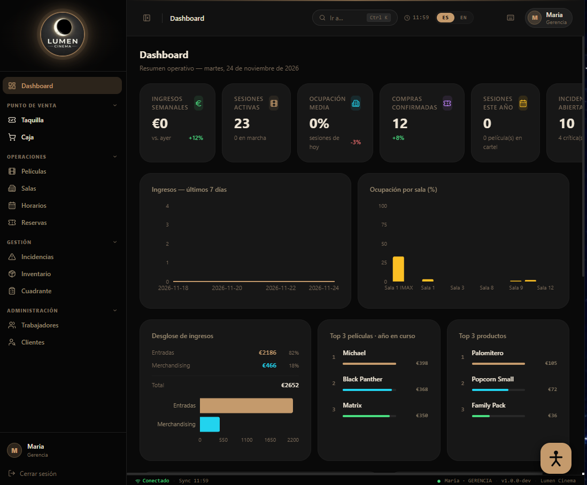
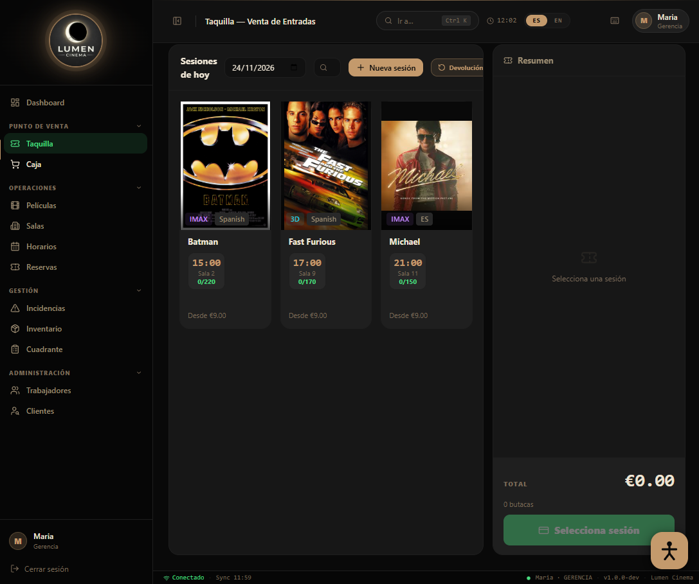
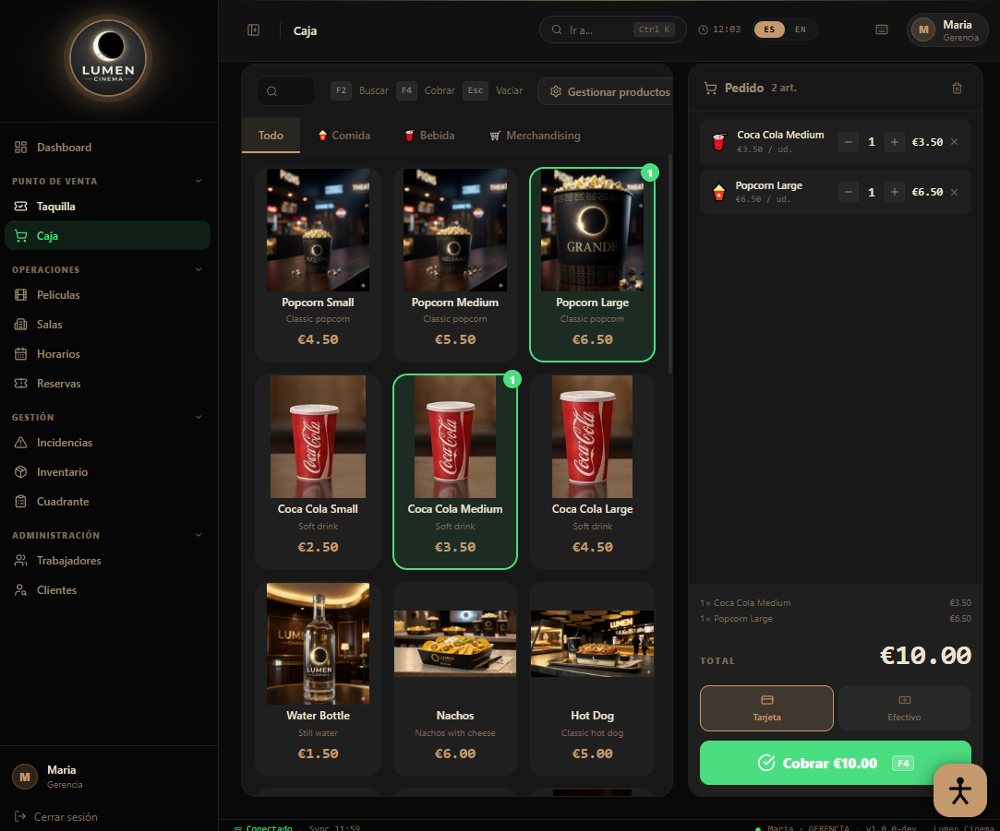

# Lumen Cinema

Sistema de gestión para un cine, con dos aplicaciones sobre una misma API: una
**intranet** para el personal (taquilla, cartelera, almacén, turnos,
incidencias, cuadro de mando) y una **tienda** para clientes (cartelera,
selección de butacas y compra).

Proyecto final de bootcamp, retomado después y reescrito en las partes que no
estaban terminadas. El historial de este repositorio empieza en esa segunda
etapa; los apartados de [decisiones](#decisiones-de-ingeniería) explican qué se
cambió y por qué, que es la parte interesante.

---

## Capturas

**Cuadro de mando** — ingresos, ocupación por sala y lo más vendido, para gerencia.



**Taquilla** — sesiones del día con su sala y aforo, para vender entradas en el mostrador.



**Caja** — venta de comida, bebida y merchandising con atajos de teclado.



---

## Stack

| Capa | Tecnología |
|---|---|
| Backend | Java 21 · Spring Boot 4 · Spring Security · JPA/Hibernate · MySQL 8 |
| Frontend | React 19 · Vite 8 · React Router 7 · CSS Modules · Recharts |
| Autenticación | JWT (jjwt) con autorización por rol y por propiedad del recurso |
| Pagos | Stripe (modo test) |
| Otros | Cloudinary (imágenes) · OpenPDF + ZXing (entradas en PDF con QR) · Swagger |
| Tests | JUnit 5 · Mockito · MockMvc (807) · Vitest + Testing Library (904) |

---

## Arrancarlo

### Con Docker, un comando

```bash
cp .env.example .env
docker compose up --build
```

- Aplicación: <http://localhost:8081>
- API y documentación: <http://localhost:8080/swagger-ui.html>

El `.env.example` trae valores de desarrollo, así que arranca sin dar de alta
nada en ningún servicio externo. Las funciones que dependen de terceros
(imágenes, correo, cobro real) quedan inactivas hasta que pongas claves
propias; el resto funciona.

### En local, sin Docker

**Backend** — necesita Java 21 y un MySQL con una base de datos `cinema`:

```bash
cd backend
./setup-local.ps1          # genera application-local.properties con un JWT_SECRET aleatorio
./mvnw spring-boot:run -Dspring-boot.run.profiles=local
```

**Frontend**:

```bash
cd frontend
npm install
npm run dev
```

### Cuentas de ejemplo

Las siembra `DataInitializer` al arrancar.

| Acceso | Email | Contraseña |
|---|---|---|
| Intranet · Gerencia | `gerencia@lumen.es` | `lumen2026` |
| Intranet · Cajero | `cajero@lumen.es` | `lumen2026` |
| Intranet · Mantenimiento | `mantenimiento@lumen.es` | `lumen2026` |
| Intranet · Limpieza | `limpieza@lumen.es` | `lumen2026` |
| Tienda · Cliente | `cliente@lumen.com` | `lumen2024` |

La intranet está en `/login` y la tienda en `/shop`. Cada una tiene su propia
sesión, así que puedes tener las dos abiertas a la vez.

---

## Arquitectura

```
lumen-cinema/
├── backend/          Spring Boot — API REST
│   └── src/main/java/com/cine/demo/
│       ├── controller/   Endpoints. Cada uno declara qué rol necesita.
│       ├── service/      Reglas de negocio (interfaz + impl)
│       ├── repository/   Spring Data JPA
│       ├── model/        Entidades y enums
│       ├── dto/          request/ y response/, separados de las entidades
│       ├── mapper/       Entidad <-> DTO
│       ├── security/     JWT, cadena de filtros y anotaciones de acceso
│       └── exception/    Excepciones de dominio + handler global
└── frontend/         React — intranet y tienda
    └── src/
        ├── pages/        Una carpeta por área; shop/ es la tienda
        ├── components/   ui/ (primitivas) y shared/ (compuestos)
        ├── services/     Cliente HTTP y un servicio por recurso
        ├── contexts/     Sesión de personal y sesión de cliente
        └── i18n/         Español e inglés
```

### Roles

La autorización de la intranet gira sobre cuatro roles de empleado, y los
clientes tienen el suyo:

| Rol | Alcance |
|---|---|
| `GERENCIA` | Todo: cuadro de mando, personal, catálogo, informes, clientes, devoluciones |
| `CAJERO` | Taquilla, tienda de productos, reservas y consulta de turnos |
| `MANTENIMIENTO` | Incidencias y consulta de turnos |
| `LIMPIEZA` | Consulta de turnos |
| `CLIENT` | Lo propio: sus compras, sus entradas y su ficha |

El catálogo de películas y sesiones es público, para que la tienda funcione sin
necesidad de cuenta.

---

## Decisiones de ingeniería

Lo que sigue son los problemas que tenía la primera versión y cómo se
resolvieron. Están aquí porque explican la forma del código actual.

### La autorización no existía

La cadena de Spring Security terminaba en `anyRequest().permitAll()` y solo 2 de
los 20 controladores declaraban rol. La única barrera real era un par de
comparaciones de prefijo de ruta dentro del filtro JWT. En la práctica,
cualquier cliente que se registrara podía invocar los endpoints de
administración: listar el personal, borrar películas, leer la facturación.

Ahora el criterio por defecto es el contrario — `anyRequest().authenticated()`,
con las rutas públicas declaradas una a una — y cada endpoint lleva su política
en una anotación legible (`@ManagementOnly`, `@BoxOffice`, `@AnyEmployee`,
`@MaintenanceOrManagement`). Una ruta nueva que nadie recuerde anotar queda
cerrada, no abierta.

El rol no basta, porque todos los clientes son `CLIENT`: sin más, uno podía leer
y modificar la ficha o las compras de otro cambiando el id de la URL.
`OwnershipGuard` responde a la otra pregunta, "es tuyo", y se invoca desde las
anotaciones.

### El registro de clientes no podía funcionar

Tres fallos encadenados: el endpoint público no existía (el filtro declaraba
pública una ruta vacía), la tienda llamaba a uno que exigía token, y ese
devolvía un DTO sin token cuando el frontend esperaba `{ token, user }`.

Sí había un formulario de alta incrustado en la página de butacas, para darse de
alta en mitad de la compra, pero lo rompía la misma cadena. Lo que no existía era
una pantalla de registro propia: el layout invitaba a registrarse y el rótulo no
era ni un enlace, además de estar oculto por CSS en móviles.

Había una consecuencia menos visible. El frontend enviaba `dateOfBirth` y el
backend esperaba `birthDate`, así que la fecha de nacimiento se perdía — y una
fecha nula se interpretaba como mayoría de edad *y* omitía la comprobación de
calificación por edad. Es decir: ninguna cuenta creada en la tienda tenía
control de edad. Ahora el dato es obligatorio y su ausencia se resuelve en
contra.

El alta tampoco acepta `role`, `userType` ni condición de estudiante. El primero
decidiría el propio nivel de acceso; los otros fijan el precio de la entrada
(6 € de estudiante frente a 9 € de adulto), así que autodeclararse estudiante
era una rebaja que nadie verificaba. El tipo se deriva de la fecha de
nacimiento y la condición de estudiante la acredita el personal.

### El importe del pago lo decidía el cliente

`createPaymentIntent` recibía el importe en la petición y lo enviaba a Stripe
tal cual, sin compararlo nunca con el total de la compra. Validado solo con
`@Positive`, bastaba pedir un céntimo por una compra de cincuenta euros: el
webhook la marcaba pagada igualmente. El importe se calcula ahora en el
servidor, sumando entradas y productos y restando descuentos, y el campo
desapareció del DTO.

El webhook tenía además tres problemas de ciclo de vida: una firma inválida
devolvía 500 y Stripe reintentaba el evento durante días; un evento de pago
fallido cancelaba la compra sin mirar su estado, de modo que si llegaba después
del de éxito —Stripe no garantiza el orden— dejaba cancelada una compra ya
cobrada; y la reserva de stock se comprobaba al confirmar, con el dinero ya
cobrado, lanzando una excepción que dejaba al cliente cobrado y sin compra.

### Los secretos estaban en el repositorio

Había credenciales con valor literal en `application.properties` y en la
documentación, incluido un `jwt.secret` por defecto en el propio código: con el
repositorio público, cualquiera podía firmarse un token de gerencia contra un
despliegue que no definiera la variable.

Ahora ninguna clave tiene valor por defecto. Si falta una variable, la
aplicación **no arranca** y dice cuál: un arranque con un secreto por defecto
conocido es peor que un arranque fallido, porque nadie se entera. Como una
variable ausente producía antes errores desconcertantes —un `DB_PASS` olvidado
acababa en `Access denied for user 'root'`— `RequiredConfigValidator` comprueba
las doce claves obligatorias antes de instanciar beans y las lista todas de
golpe.

El CORS usaba `allowedOriginPatterns("*")` junto a `allowCredentials(true)`.
Con patrones, Spring refleja el origen que pida el navegador, así que cualquier
web podía hacer peticiones con credenciales. Es ahora una lista blanca de
orígenes exactos, y el arranque falla si alguien escribe `*`.

### Los tests medían cobertura, no comportamiento

El patrón se veía en los dos lados. En el backend, JaCoCo excluía del informe
los 21 servicios, los DTO, los enums y los repositorios: toda la lógica de
negocio quedaba fuera y el porcentaje solo reflejaba lo ya cubierto. En el
frontend había siete ficheros `pages.*.test.jsx` (`coverage`, `deep`,
`deepFlow`, `final`, `interactions`, `precise`, `smoke`) y ocho solo para la
página de taquilla, mientras que la tienda —el código más nuevo, el que da de
alta a los clientes— no tenía ninguno.

Y había tests que no probaban nada. `CorsConfigTest` afirmaba que el bean no
fuera nulo, cosa que pasaba igual con el comodín. `SecurityConfigTest`
comprobaba que la clase llevara una anotación, lo cual pasaba igual con
`permitAll()`. En `JwtUtilTest`, un helper manipulaba por reflexión un campo que
solo se lee al generar el token, así que no hacía nada y el test pasaba por otro
motivo.

Se quitaron las exclusiones y se añadió lo que faltaba: una matriz de
autorización de 28 casos que afirma el 403 endpoint por endpoint, y una
regresión explícita por cada fallo descrito arriba.

---

## Tests

```bash
cd backend  && ./mvnw test     # 807
cd frontend && npm test        # 904
```

Cobertura del backend, sin exclusiones: **90,3 % de instrucciones y 74,1 % de
ramas**. El informe se genera en `backend/target/site/jacoco/index.html`.

Que ese informe exista tiene su propia historia: Surefire necesita `@{argLine}`
para evaluar tarde la propiedad que JaCoCo define en ejecución, y sin eso el
agente se configuraba pero no se acoplaba al proceso de test. Es decir, no había
informe en absoluto — lo que encaja con que nadie notara que las exclusiones
tapaban toda la lógica de negocio.

---

## Qué falta

Por honestidad, lo que queda pendiente y por qué:

- **Migraciones de base de datos.** Hoy conviven `ddl-auto=update`, `schema.sql`
  y `seed.sql`, así que no hay una fuente única del esquema. Lo correcto es
  Flyway con `schema.sql` como migración base. No está hecho porque no se pudo
  verificar contra una base de datos real, y publicar migraciones sin probarlas
  es peor que no tenerlas.
- **Verificación de email en el alta.** El correo de bienvenida se envía, pero
  la cuenta queda activa sin confirmar la dirección.
- **Servicios grandes.** `ScreeningServiceImpl` y `PurchaseServiceImpl` acumulan
  demasiadas reglas y pedirían extraer clases de dominio (solapes de sala,
  política de asientos).
- **El arranque con Docker no está ejecutado.** Los `Dockerfile` y el
  `docker-compose.yml` están escritos y la configuración de nginx es la
  estándar para una SPA con proxy, pero en la máquina donde se preparó esto no
  había Docker instalado, así que ese camino no se ha corrido de punta a punta.
  Lo verificado es el arranque local: `./mvnw test`, `./mvnw spring-boot:run` y
  `npm run build` con la suite de frontend completa.
- **Límite de intentos distribuido.** El contador de `AuthRateLimitFilter` vive
  en memoria, así que con varias instancias el límite sería por instancia.
  Bastaría moverlo a un almacén compartido.
